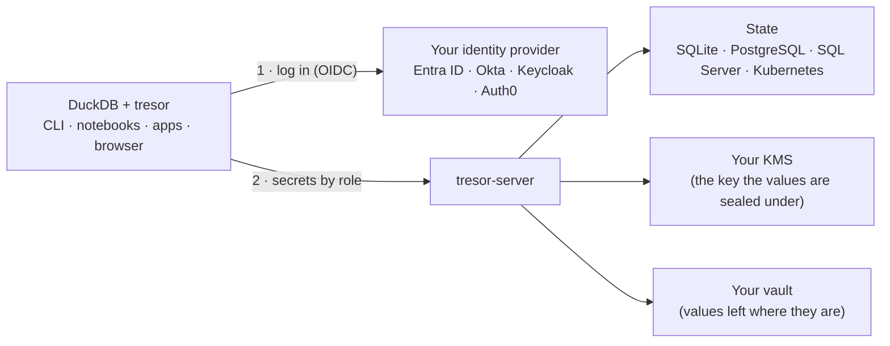

<p align="center">
  <picture>
    <source media="(prefers-color-scheme: dark)" srcset="website/static/img/tresor-icon-dark.svg">
    
  </picture>
</p>

<h1 align="center">tresor-server</h1>

<p align="center">
  <b>The secrets service behind tresor: your company login, your role's secrets — in DuckDB.</b><br>
  <a href="https://hugr-lab.com/tresor">Website</a> ·
  <a href="https://hugr-lab.com/docs/tresor-server/">Docs</a> ·
  <a href="https://hugr-lab.com/docs/tresor-server/quickstart/">Quickstart</a> ·
  <a href="https://github.com/hugr-lab/tresor">tresor (the extension)</a>
</p>

<p align="center">
  <a href="https://github.com/hugr-lab/tresor-server/actions/workflows/ci.yml"></a>
  <a href="https://github.com/hugr-lab/tresor-server/releases/latest"></a>
  <a href="LICENSE"></a>
</p>

DuckDB reads anything - until the data is your company's. Then the keys start spreading: an S3 key in a notebook, a
database password in `.env`, a shared token in CI. Every copy is one more thing to rotate, one more thing to leak, and
nobody can say who used what.

**tresor-server** keeps those secrets in one place and hands each person exactly what their roles allow. With
[tresor](https://github.com/hugr-lab/tresor) - a DuckDB community extension - people log in once with their company
identity, and the secrets become part of DuckDB's own lookup:

```sql
INSTALL tresor FROM community;
ATTACH 'tresor:secrets.corp.example' AS corp;   -- your company login (Entra ID, Okta, Keycloak, Auth0)
FROM 's3://lake/sales/*.parquet';                -- the right secret is found by scope, as any DuckDB secret
```

## What it does

- **Administrators manage, roles use.** Secrets and variables are granted to roles and groups from your identity
  provider - in the [console](https://hugr-lab.com/docs/tresor-server/console/) or from DuckDB. Revoke a grant, and
  the next query no longer sees the secret.
- **Your key, your vault.** Values are sealed under a key in your KMS - Azure Key Vault, AWS KMS, GCP Cloud KMS,
  OpenBao/Vault - or left where they already are and referenced (`ref+vault://…`, `ref+azkv://…`, AWS and GCP secret
  managers, Kubernetes Secrets).
- **Short-lived, per user.** A parameter can be minted for each caller: their own token for an API, temporary cloud
  credentials, a database login, a Snowflake token - expiring, renewed by the next query
  ([generated parameters](https://hugr-lab.com/docs/tresor-server/generated/)).
- **No password of its own.** The service reaches its key, its vault and its database with the platform's identity:
  managed and workload identities, IAM roles, service accounts.
- **Audited.** Every read and change is an event (OpenTelemetry), named by who and what - never a value.

## How it works



1. **DuckDB logs in** with your identity provider - in the browser or with a device code, once.
2. **tresor-server answers with what the caller's roles may use** - names, types and scopes only. A value is fetched
   when a query needs it, and never written to disk on the client.
3. **The service keeps** grants and sealed values in its database, under a key in your KMS; references are read
   from your vault at each fetch.

The protocol is open - [`duckdb-secrets/1`](https://hugr-lab.com/docs/tresor/protocol/) - and tresor's conformance
suite runs against tresor-server on every state store in CI.

## Try it in 5 minutes

```bash
git clone https://github.com/hugr-lab/tresor-server && cd tresor-server/deploy/docker
docker compose up -d                          # the service, Keycloak with a realm, people and services
docker compose --profile seed run --rm seed   # a sample secret granted to the analysts
docker compose run --rm init passwords        # who signs in with what (made on the first run)
```

```sql
INSTALL tresor FROM community;
LOAD tresor;
ATTACH 'tresor:127.0.0.1:8443' AS corp (INSECURE_HTTP true);   -- sign in as jonas, an analyst
FROM corp.whoami();
FROM corp.secrets();
```

The console is at <http://127.0.0.1:8443/ui/> (anna, an administrator). Your own identity provider in one
`docker run`, and what to have at hand first: [Quickstart](https://hugr-lab.com/docs/tresor-server/quickstart/).

## Deploy

| Where | How |
| --- | --- |
| One host | [Docker Compose](https://hugr-lab.com/docs/tresor-server/docker/) behind Caddy's HTTPS, SQLite or PostgreSQL |
| Kubernetes | the Helm chart `oci://ghcr.io/hugr-lab/charts/tresor-server` - [Kubernetes](https://hugr-lab.com/docs/tresor-server/kubernetes/) |
| Azure | Container Apps with Azure SQL or PostgreSQL and Key Vault - [Azure](https://hugr-lab.com/docs/tresor-server/azure-container-apps/) |
| AWS | ECS (Terraform) or EKS, RDS, KMS, Secrets Manager - [AWS](https://hugr-lab.com/docs/tresor-server/aws/) |
| GCP | Cloud Run (Terraform) or GKE, Cloud SQL, Cloud KMS, Secret Manager - [GCP](https://hugr-lab.com/docs/tresor-server/gcp/) |
| OpenBao / Vault | the key in Transit, references to KV, database credentials - [Vault](https://hugr-lab.com/docs/tresor-server/vault/) |

The image is `ghcr.io/hugr-lab/tresor-server` (distroless, non-root; `:vX.Y.Z` from a release). Releases are signed:
[verifying](https://hugr-lab.com/docs/tresor-server/security/#verifying-the-artifacts) ·
[supported versions](https://hugr-lab.com/docs/tresor-server/support/) · [SECURITY.md](SECURITY.md).

## Develop

Go 1.27, no cgo:

```bash
go test ./...                                     # GOWORK=off inside a go.work tree
go build -o tresor-server ./cmd/tresor-server
scripts/ci/tresor_checkout.sh ../tresor-pin --submodules && scripts/ci/conformance.sh ../tresor-pin sqlite
```

[Development](https://hugr-lab.com/docs/tresor-server/development/) has the rest: the tests per store, tresor's
conformance suite, the chart, the live cloud runs. Changes go through a spec in [specs/](specs/README.md). Parts of
the code started as tresor's reference server (MIT, the same owner): see [NOTICE](NOTICE).

## License

[Business Source License 1.1](LICENSE): free in production, embedding included; a commercial licence only to offer it
to others as a hosted or managed service. Each version becomes Apache-2.0 four years after its release.
