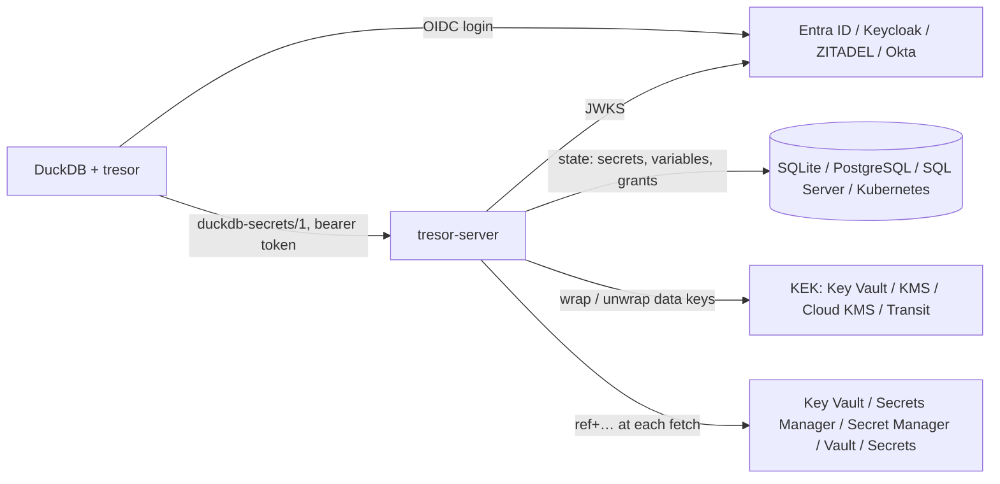

# tresor-server

tresor-server is the production service behind [tresor](https://hugr-lab.github.io/tresor/), the DuckDB
extension. DuckDB attaches it:

```sql
ATTACH 'tresor:secrets.corp.example' AS corp;
```

The attach logs DuckDB in through the organization's identity provider. From then on, the secrets the
caller's roles may use take part in DuckDB's own secret lookup.

The service speaks tresor's open protocol, [`duckdb-secrets/1`](https://hugr-lab.github.io/tresor/protocol/).
tresor's conformance suite runs against it in CI, on every state store.

**New here?** The [Quickstart](quickstart.md) runs it in five minutes - with a demo identity provider, or yours.

## What it adds to tresor's reference server

tresor's reference server proves the protocol. It is one process with one encrypted file. tresor-server is
what an organization runs:

- **State in its database.** SQLite for one replica; PostgreSQL, SQL Server (Azure SQL) or the Kubernetes API
  (custom resources, no database) for several.
- **Material sealed under a KMS key.** The key-encryption key (KEK) stays in Azure Key Vault or Managed HSM, AWS
  KMS, GCP Cloud KMS or OpenBao/Vault Transit; the service keeps only wrapped data keys.
- **Material left where it is.** A secret's parameter can be a reference, `ref+azkv://corp-vault/lake-s3`:
  the value stays in Azure Key Vault, AWS Secrets Manager, GCP Secret Manager, OpenBao/Vault or a Kubernetes
  Secret, and is read at each fetch. A rotation there reaches DuckDB at once.
- **Values made per caller.** A parameter can be a token minted for the caller, a claim of their token, or what a
  service login got ([Generated parameters](generated.md)); variables beside secrets ([Variables](variables.md)).
- **No password of its own.** The service logs in with its platform's identity - a managed or workload identity
  on Azure, IAM roles on AWS, a service account on GCP, a ServiceAccount token for Vault - to its KEK, its
  references and its database.
- **One container.** A distroless image; a Helm chart, and recipes for Azure Container Apps, ECS and Cloud Run.
- **A console** for administrators, at `/ui/` ([Console](console.md)).

## How it fits together



## Where to go next

- [Getting started](getting-started.md): the service on a laptop, then DuckDB against it.
- [Configuration](configuration.md): every setting, in a file or in the environment.
- [Azure Container Apps](azure-container-apps.md): a deployment with a database, Key Vault and a managed
  identity.
- [Kubernetes](kubernetes.md), [AWS](aws.md), [GCP](gcp.md), [OpenBao and Vault](vault.md): the chart and the
  other platforms.
- [Security](security.md): what the service guarantees, and what it trusts.

## License

Business Source License 1.1. Production use is permitted, provided you do not offer tresor-server - or a
service whose value derives substantially from it - to third parties as a hosted or managed service. Each
version becomes Apache-2.0 four years after it is first published. See the
[LICENSE](https://github.com/hugr-lab/tresor-server/blob/main/LICENSE).
